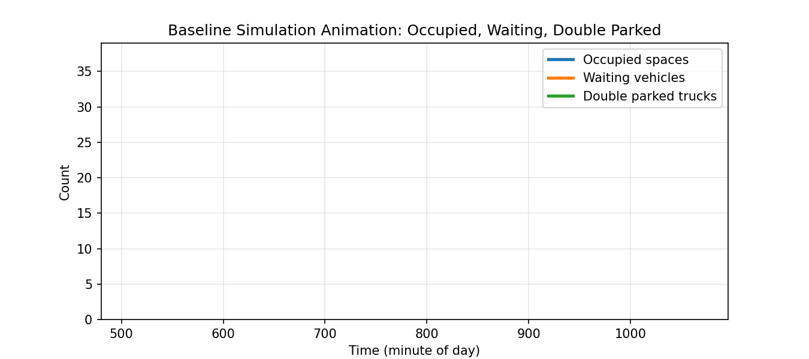

# Curbside Parking Simulation and Policy Evaluation

**Course project:** CE 2710 — Introduction to Transportation Engineering, George Washington University (2026)  
**Study area:** Science and Engineering Hall (SEH), Washington, DC

## Overview

This project models curbside parking and loading activity around GWU's Science and Engineering Hall and compares an existing parking configuration with a modified curb-allocation scenario. The model evaluates parking availability, vehicle departures, cruising/waiting delays, failed parking attempts, and delivery-truck double parking.

The study uses **38 curbside spaces** and a synthetic demand sample of **200 passenger cars and 16 delivery trucks**. It is a transportation-system simulation project, not an autonomous-driving or autonomous-vehicle controller.

## Simulation approach

1. Generate passenger-car and delivery-truck arrivals and parking durations.
2. Define which of the 38 spaces can accommodate each vehicle type.
3. Load vehicles and spaces into a minute-by-minute simulation.
4. Record parking, waiting, double-parking, departure, and failure states.
5. Compare the baseline and enhanced scenarios using CSV outputs, plots, and animations.

| Parameter | Baseline | Enhanced |
| --- | --- | --- |
| Total curbside spaces | 38 | 38 |
| Truck-enabled loading spaces | 2 (also available to cars) | 4 (truck-only) |
| Passenger-car parking duration | 1.0–2.0 h | 0.75–1.25 h |
| Maximum passenger-car waiting time | 15 min | 10 min |
| Total simulated vehicles | 216 | 216 |

The enhanced scenario changes **multiple assumptions simultaneously**, so results should not be attributed to a single change without further experiments.

## Results

The CSV outputs currently included in this repository are a **single saved simulation run**:

| Metric | Baseline | Enhanced |
| --- | ---: | ---: |
| Departed vehicles | 212 / 216 | 216 / 216 |
| Failed vehicles | 4 | 0 |
| Trucks that double-parked | 15 | 0 |
| Average waiting time (min) | 0.731 | 0.000 |

The simulation incorporates stochastic vehicle arrivals, parking durations, and parking assignments. Therefore, numerical outcomes may vary between runs. The results presented above correspond to one saved simulation run and should be interpreted within the assumptions and limitations of the model. Multiple independent runs would be required to assess the variability and robustness of the proposed curb-management strategy.

**Baseline simulation:**



**Enhanced simulation:**


Additional plots and data are available in `results/`.

## Repository contents

```text
.
├── scripts/
│   ├── s1_gen_demands.py
│   ├── s1_gen_demands_enhanced.py
│   ├── s1_gen_lots.py
│   ├── s1_gen_lots_enhanced.py
│   ├── s2_api.py
│   └── s3_sim.py
├── data/
│   ├── drivers.csv
│   ├── drivers_enhanced.csv
│   ├── parking_lots.csv
│   └── parking_lots_enhanced.csv
├── results/
│   ├── base_conditions/
│   ├── enhanced/
│   └── comparison/
├── run_simulation.ipynb
└── requirements.txt
```

## Running the project

Requires Python 3 and the packages listed in `requirements.txt`.

```bash
python -m pip install -r requirements.txt
jupyter notebook run_simulation.ipynb
```

Run notebook cells in order to regenerate inputs, execute the baseline and enhanced simulations, and create comparative figures.

Alternatively, regenerate input datasets and run the command-line simulation:

```bash
python scripts/s1_gen_demands.py
python scripts/s1_gen_lots.py
python scripts/s1_gen_demands_enhanced.py
python scripts/s1_gen_lots_enhanced.py
python scripts/s3_sim.py --drivers data/drivers.csv --lots data/parking_lots.csv
python scripts/s3_sim.py --drivers data/drivers_enhanced.csv --lots data/parking_lots_enhanced.csv
```

The command-line runs export CSV results to the top-level `results/` directory. The notebook organizes the outputs in scenario subfolders and generates the visualizations.

## Scope and limitations

- Synthetic demand and a simplified curbside parking model; no observational traffic validation is claimed.
- A single study area and a single enhanced policy configuration.
- Simplified passenger-car search and truck double-parking behavior.
- No detailed street-network or traffic-lane simulation.
- The baseline scenario has stochastic vehicle assignment; repeated-run validation and consistent random seeding are future improvements.

## Academic context

Developed as part of **CE 2710 — Introduction to Transportation Engineering** at George Washington University, with instruction by Prof. Zhengtian Xu. This repository contains simulation code, data, and generated outputs from the course project.

## Contact

[GitHub profile](https://github.com/ahmadmnsourr) · [ORCID](https://orcid.org/0009-0002-5645-3992) · [Google Scholar](https://scholar.google.com/citations?user=H0kIChkAAAAJ)
